# BreachPath

Enterprise breach analysis and containment optimisation, written in Java 17+.

BreachPath is a defensive tool. It takes a simulated enterprise network and a log of security
alerts, works out how an attacker could move from a compromised host to a protected target,
ranks the incidents by risk, and recommends the cheapest way to cut the attacker off. It runs as
a web application (Java REST API plus browser frontend), as a console report, and as a JavaFX
dashboard.

All data is synthetic. The results are experiments on that data, not proof of real-world protection.

## Screenshots

  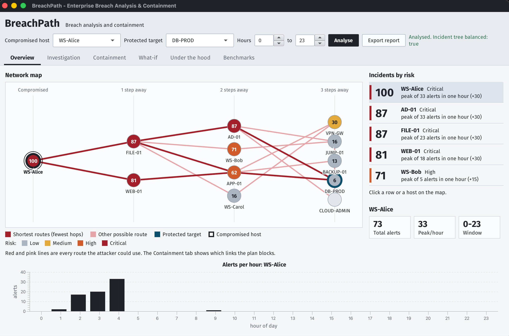

<em>Overview: choose the compromised host and the systems to protect, then see the risk ranking and the network map.</em>

 

<table>
  <tr>
    <td align="center">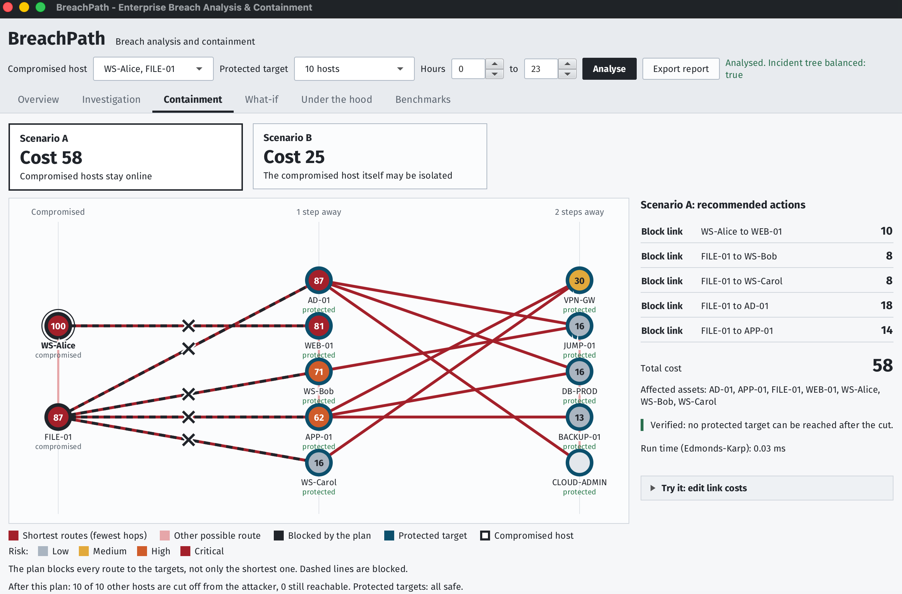 <b>Containment, scenario A</b> Infected machines stay online. The plan blocks links and is checked.</td>
    <td align="center">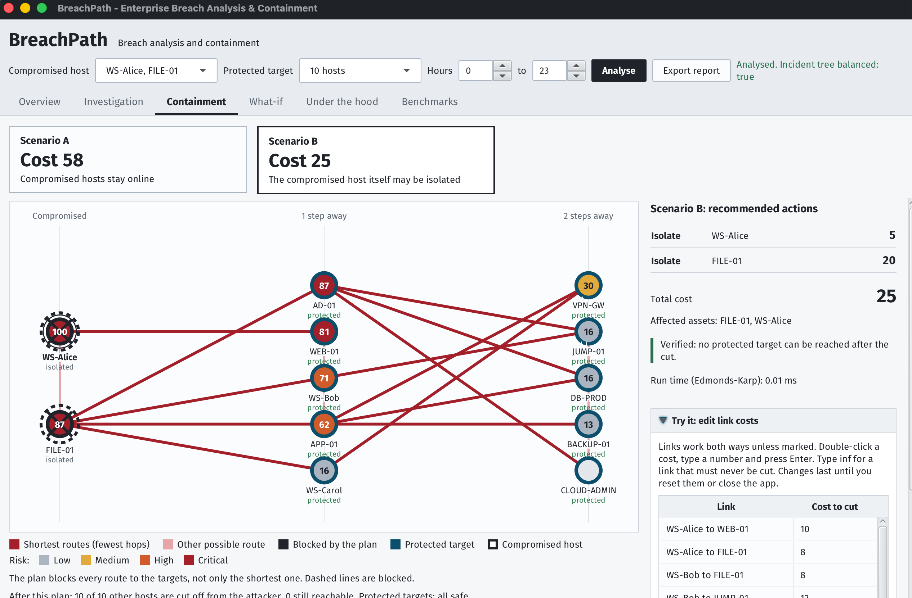 <b>Containment, scenario B</b> Infected machines are isolated. Usually cheaper, also checked.</td>
  </tr>
</table>

 

<table>
  <tr>
    <td align="center">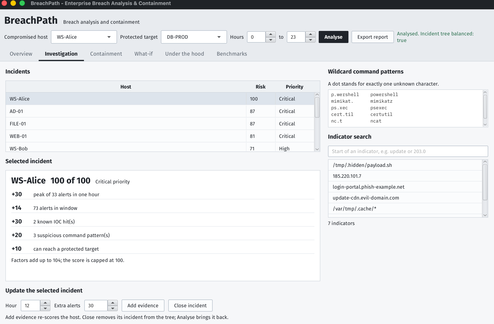 Investigation: why an incident has its score</td>
    <td align="center">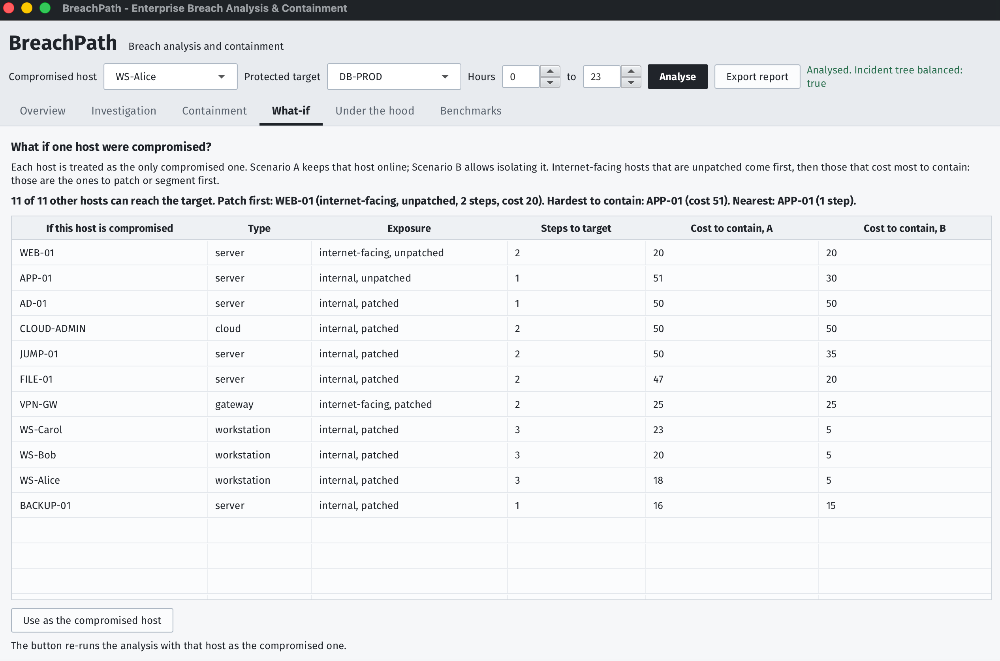 What-if: each host as the only compromised one</td>
  </tr>
  <tr>
    <td align="center">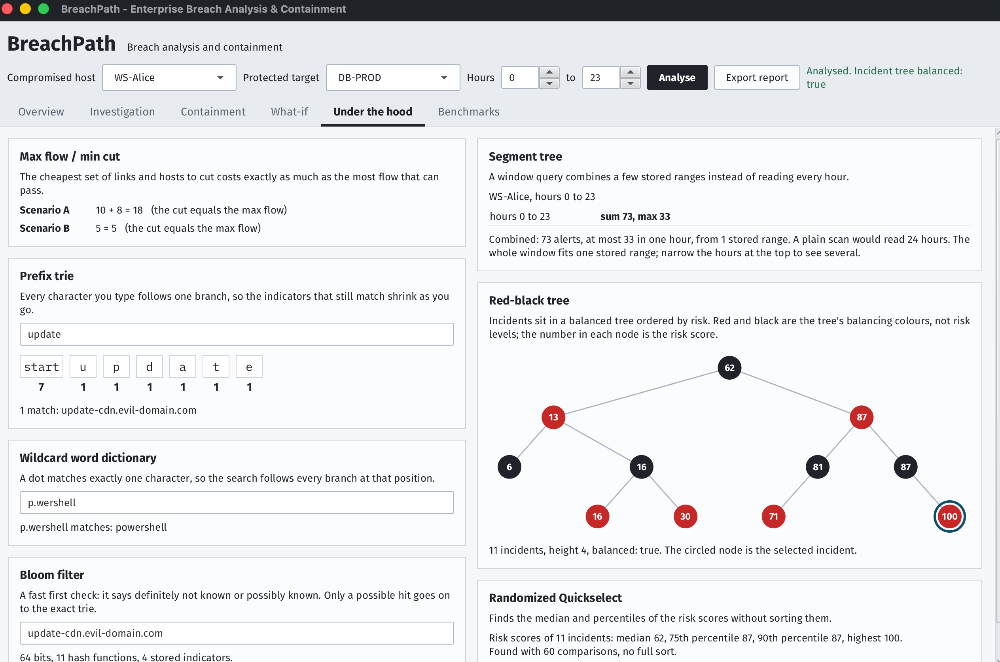 Under the hood: each data structure on the current data</td>
    <td align="center">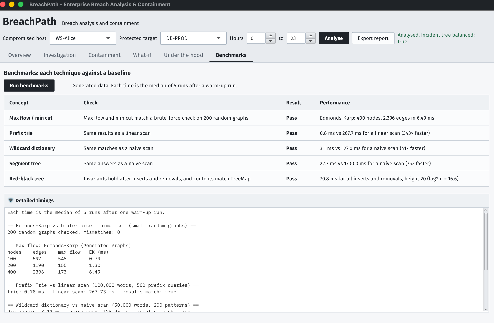 Benchmarks: each technique against a plain baseline</td>
  </tr>
  <tr>
    <td align="center">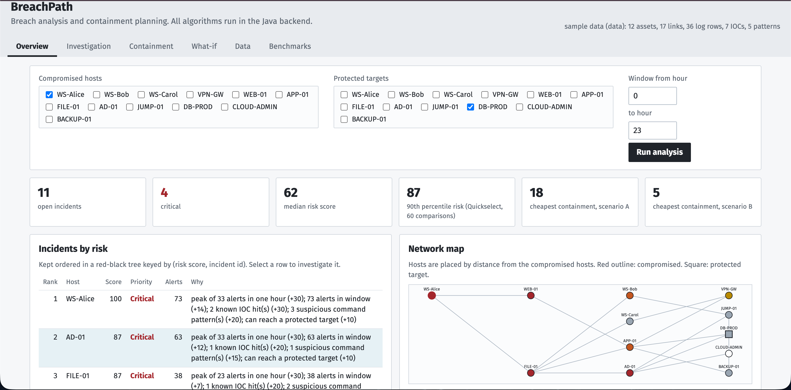 Web app: overview with risk cards</td>
    <td align="center">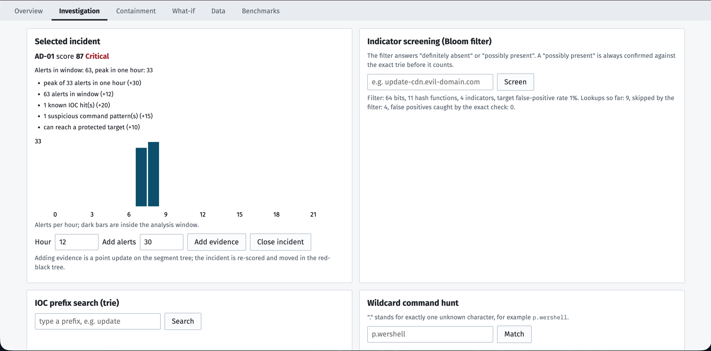 Web app: investigation and Bloom filter check</td>
  </tr>
  <tr>
    <td align="center">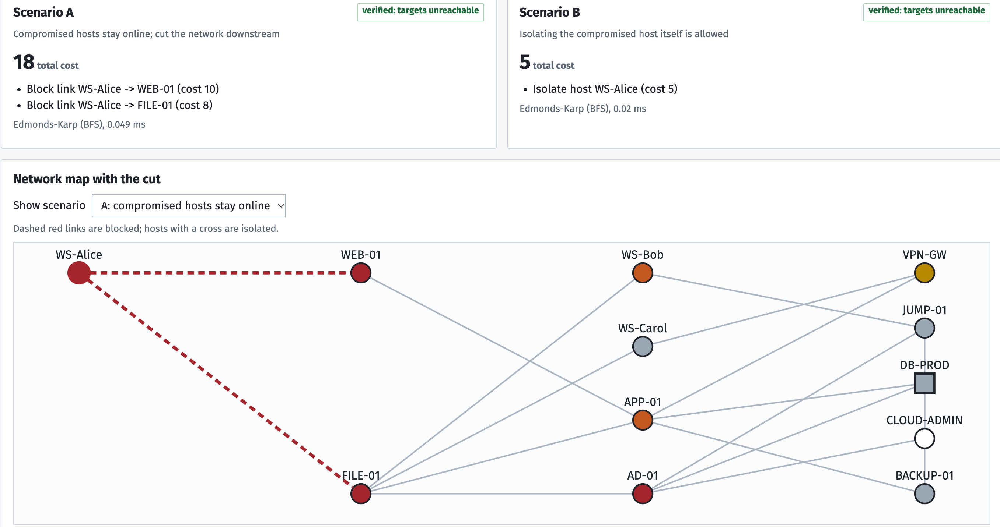 Web app: containment map</td>
    <td align="center">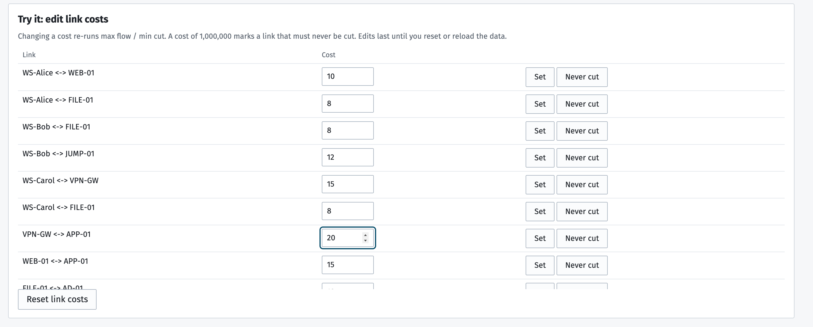 Web app: containment plan and cost</td>
  </tr>
  <tr>
    <td align="center">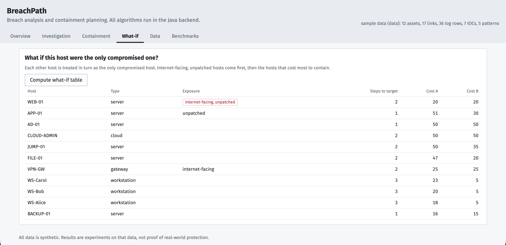 Web app: what-if table</td>
    <td align="center">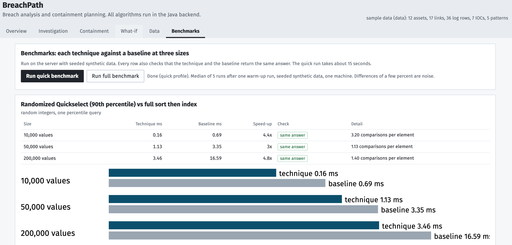 Web app: benchmarks</td>
  </tr>
  <tr>
    <td align="center" colspan="2">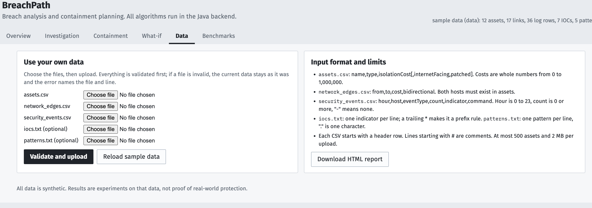 Web app: upload and validate your own data</td>
  </tr>
</table>

The first group is the JavaFX dashboard (Overview, both containment scenarios, Investigation, What-if, Under the hood, Benchmarks). The second group is the web application. All use the sample data.

## What it does

1. Loads a network of hosts and links, a log of hourly alert counts, known indicators of compromise
   (IOCs) and wildcard hunting patterns from the `data/` folder, or from files uploaded in the
   browser. Bad input is rejected with the file, line and column of the problem.
2. Finds the shortest attack paths (every route of the fewest hops) from each compromised host to each
   protected target, and shows all other possible routes on the network map.
3. Searches the evidence: IOC screening and prefix search, wildcard command patterns, and alert
   totals and peaks over a chosen time window.
4. Scores every host with an explainable risk score and keeps the incidents ordered by risk.
5. Summarises the score distribution (median, 75th and 90th percentile) with randomized selection.
6. Computes the cheapest containment with max flow / min cut, in two scenarios: compromised hosts
   stay online (A), or isolating the compromised host itself is allowed (B).
7. Checks each plan by removing the chosen links and hosts and confirming that no target is still
   reachable.
8. Benchmarks every technique against a plain baseline at three input sizes.
9. Exports the analysis as a single HTML report you can open in a browser or print to PDF.

## The seven techniques

Each technique solves a different part of the problem, and they feed one another. All of them are
implemented in this repository; the JDK collections are used only for plumbing and as test baselines.

| Technique | Syllabus unit | Where | Role |
|---|---|---|---|
| Max flow / min cut (Edmonds-Karp) | 5 | `graph/`, `engine/ContainmentPlanner` | cheapest hosts and links to isolate |
| Bloom filter | 6 (CO5) | `bloom/BloomFilter`, `engine/IocEngine` | fast "definitely absent / possibly present" screen of indicators |
| Randomized Quickselect | 6 (CO5) | `select/RandomizedSelect`, `ui/DashboardModel` | median and percentiles of incident risk without sorting |
| Prefix trie | 4 | `trie/Trie`, `engine/IocEngine` | exact confirmation of indicators, prefix search |
| Wildcard word dictionary | 4 | `trie/WordDictionary`, `engine/PatternEngine` | hunt with partially known commands (`.` = one character) |
| Segment tree | 3 | `segmenttree/`, `engine/EventTimeline` | alert totals and peaks over time windows |
| Red-black tree | 3 | `rbtree/`, `engine/IncidentIndex` | incidents ordered by (riskScore, incidentId) |

How they fit together:

1. The segment tree turns the alert log into window totals and peaks.
2. The Bloom filter screens each indicator. Only "possibly present" answers reach the trie, which confirms them exactly. The tries also match command patterns.
3. The risk scorer combines these findings and keeps each host's incident in the red-black tree, so the highest risk is always at hand.
4. Randomized Quickselect reads the score distribution without sorting it.
5. The flow engine calculates containment from the isolation and link costs in the data.

### Bloom filter (probabilistic component)

The filter holds every exact indicator. It is sized for a 1% false-positive rate (about 10 bits per indicator, m = -n ln p / (ln 2)^2 bits and k = (m / n) ln 2 hash functions, from two 64-bit hashes by double hashing).

| Answer | Meaning |
|---|---|
| Definitely absent | Certain. The filter has no false negatives. |
| Possibly present | Never trusted alone. The exact trie always confirms it, so a false positive cannot flag a clean indicator. |

- Results are identical to a trie-only engine (checked by the tests on 20,000 random probes).
- Prefix rules (`203.0.113.*`) are matched by the prefix trie, because a Bloom filter cannot answer prefix questions.
- Limit: against an in-memory trie it saves little or no time. It pays off when the exact check is expensive (a database or remote feed). In the benchmark about half of the lookups never reach the trie.

### Randomized Quickselect

Finds the k-th smallest value without sorting.

- **How:** partition around a random pivot, then follow only the side that holds the wanted rank.
- **Speed:** expected O(n) comparisons for any input, against O(n log n) for sorting.
- **Equal scores:** a three-way partition keeps many equal values from slowing it down.
- **Safe:** it does not modify its input.
- **Repeatable:** the dashboard uses a fixed seed, so the same data gives the same numbers. The result shows the comparisons used.
- **When to use:** one or a few percentiles. For many queries on the same data, sort once.

### Risk score

The score is capped at 100 and every point can be traced to a rule:

| Factor | Points |
|---|---|
| Peak alerts in one hour | 3 per alert, up to 30 |
| Alerts in the chosen window | 1 per 5 alerts, up to 20 |
| Known IOC hits | 20 each, up to 30 |
| Suspicious command patterns | 15 each, up to 20 |
| Can reach a protected target | 10 |
| Internet-facing and unpatched | 15 |
| Unpatched but internal | 5 |

Priority labels: 80 and above is Critical, 60 to 79 High, 30 to 59 Medium, below 30 Low.

### Containment

**How the plan is built**

| Part of the network | In the flow graph | Meaning of a cut |
|---|---|---|
| A host | An "in" node and an "out" node joined by an edge, capacity = cost of isolating it | Isolate this host |
| A link | An edge, capacity = cost of blocking it | Block this link |
| A target | Cannot be isolated | Never cut |
| A link that must never be cut | Capacity 1,000,000 (`INF` in `ContainmentPlanner`) | If it reaches a target, the plan reports that no finite-cost containment exists |

A cost means how disruptive it is to cut that host or link, so the plan is the cheapest total disruption.

**What the screens show**

- The plan cuts every route to the targets, not only the shortest one.
- The map draws the shortest routes in dark red and all other possible routes in pink. Blocked links are dashed.
- Each plan is checked independently: the chosen links and hosts are removed and a search confirms no target can be reached.
- Every host is labelled cut off, still reachable, protected target or isolated, with a one-line summary (for example "8 of 11 other hosts are cut off, 3 still reachable"). This shows what the plan does not protect.
- "Protect all other systems" ticks every host that is not compromised, so the whole network is protected.
- To protect one very important system first, choose only that system and read the labels to cross-check the others.

**Complexity**

| Item | Value |
|---|---|
| Graph size | V' = 2n + 2 nodes, E' edges |
| Augmentations | O(V'E') |
| Storage | capacity matrix, so each search costs O(V'^2) |
| Total | O(V'^3 E') worst case, O(V'^2) space |
| Textbook bound (adjacency lists) | O(V E^2) |
| Limit | 500 assets |

## Inputs, outputs, constraints and failure cases

**Inputs.** Five files in `data/` (or uploaded on the Data tab), plus the compromised hosts, the
protected targets and an hour window chosen by the user.

**Outputs.** Attack paths, a ranked incident list with the reasons for each score, score
percentiles, indicator screening results, wildcard matches, two containment plans with their
verification result, a what-if table, benchmark tables, and an HTML report.

**Constraints and assumptions.**

- Costs are whole numbers from 0 to 1,000,000. Alerts are counted per hour, hours 0 to 23.
- At most 500 assets per network. Request bodies are limited to 2 MB.
- Costs are the user's own estimates. A recommended cut is the cheapest under those costs only.
- The web server listens on 127.0.0.1 by default, so it is reachable only from your own computer.

**Failure cases and how they are handled.**

| Situation | Behaviour |
|---|---|
| Empty asset file, missing header row, wrong column count | rejected with file and line, nothing is loaded |
| Duplicate asset name, link to an unknown asset | rejected with the offending name |
| Non-numeric, negative or oversized cost; hour outside 0 to 23; negative alert count | rejected with file, line and column |
| Empty alert log, IOC list or pattern list | allowed; the analysis runs with no evidence from that source |
| Alert-log host that is not in the asset list | ignored and reported as a warning |
| Host that is both compromised and a target | rejected (HTTP 400) |
| No route from a compromised host to a target | reported as "unreachable", cost 0 |
| Uncuttable route to a target | plan marked infeasible with an explanation |
| Invalid upload | the previous data stays loaded |
| JSON error, unknown host, bad window | HTTP 400 with a message |
| Request without a JSON content type | HTTP 415 |
| Body over 2 MB | HTTP 413 |
| Analysis requested before any analysis exists | HTTP 409 |

## Data files

All files are in `data/`. Lines starting with `#` are comments.

| File | Columns or format |
|---|---|
| `assets.csv` | `name,type,isolationCost[,internetFacing,patched]` (the last two are optional and take true or false; a row without them is internal and patched) |
| `network_edges.csv` | `from,to,cost,bidirectional` |
| `security_events.csv` | `hour,host,eventType,count,indicator,command` (`-` means none; hour is 0 to 23) |
| `iocs.txt` | one exact indicator per line; a trailing `*` makes it a prefix rule |
| `patterns.txt` | one wildcard pattern per line; `.` matches exactly one character |

The CSV files need a header row. The sample data is synthetic and was written for this project.

## Requirements

- Java 17 or newer
- Maven (only needed to build with Maven and to run the JavaFX dashboard)

The web application, the console report and the tests need no libraries beyond the JDK (and JUnit
for the tests).

## Run

### Web application (REST API and browser frontend)

    mvn package
    java -cp target/breachpath-1.0.jar com.breachpath.web.WebApp

Then open http://127.0.0.1:8080/ in a browser. Optional arguments and settings (none is a secret):

    java -cp target/breachpath-1.0.jar com.breachpath.web.WebApp [dataDir] [port]
    BREACHPATH_DATA=data PORT=8080 BREACHPATH_HOST=127.0.0.1

The browser only displays results. Every algorithm runs in the Java backend. The tabs are:

- **Overview:** choose compromised hosts and targets and a time window, run the analysis, and see
  the incident ranking, score percentiles, cheapest containment costs, the network map and the
  attack paths.
- **Investigation:** all incidents with a plain explanation of each score, add evidence (re-scores
  the incident and moves it in the tree), close an incident, screen an indicator with the Bloom
  filter, search IOCs by prefix, and match wildcard patterns.
- **Containment:** the two scenarios side by side with the recommended actions, the verification
  result, and an editable link-cost panel (change a cost or mark a link as never to be cut and watch
  the plans update).
- **What-if:** treats every other host in turn as the only compromised one and shows the distance to
  the target and the cheapest containment in each scenario.
- **Data:** upload your own five files (validated before anything is replaced), reload the sample
  data, and download the HTML report.
- **Benchmarks:** runs the scaling study (quick or full) and shows each technique against its baseline.

### REST API

All responses are JSON. POST requests must send `Content-Type: application/json`.

| Method and path | Purpose |
|---|---|
| `GET /api/health` | loaded dataset summary and warnings |
| `GET /api/topology` | assets and links |
| `POST /api/analyse` | run the analysis; body `{"compromised":["WS-Alice"],"targets":["DB-PROD"],"fromHour":0,"toHour":23}` |
| `GET /api/result` | the current analysis (paths, incidents, percentiles, both plans, Bloom statistics) |
| `GET /api/incidents` | ranked incidents |
| `POST /api/incidents/evidence` | body `{"host":"WS-Bob","hour":10,"delta":40}` |
| `POST /api/incidents/close` | body `{"host":"WS-Bob"}` |
| `GET /api/ioc/screen?indicator=...` | Bloom filter answer plus exact confirmation |
| `GET /api/ioc/search?prefix=...` | IOC prefix search |
| `GET /api/patterns?pattern=p.wershell` | wildcard match (without `pattern`, all configured patterns) |
| `GET /api/whatif` | what-if sweep |
| `PUT /api/links/{index}` | change one link cost; body `{"cost":25}` (use 1000000 for "never cut") |
| `POST /api/links/reset` | restore the original link costs |
| `POST /api/data` | upload `assets`, `edges`, `events`, `iocs`, `patterns` as text fields |
| `POST /api/data/reset` | reload the sample data |
| `GET /api/benchmarks?profile=quick` | run the scaling benchmarks (`quick` or `full`) |
| `GET /api/benchmarks/last` | the most recent benchmark result |
| `GET /api/report` | the HTML report |

Examples:

    curl -s -X POST -H "Content-Type: application/json" \
      -d '{"compromised":["WS-Alice"],"targets":["DB-PROD"],"fromHour":0,"toHour":23}' \
      http://127.0.0.1:8080/api/analyse

    curl -s "http://127.0.0.1:8080/api/ioc/screen?indicator=185.220.101.7"
    curl -s "http://127.0.0.1:8080/api/ioc/screen?indicator=clean.example.org"

The first screening call answers `"bloom":"possibly present"` with `"exactConfirmed":true`. The
second answers `"bloom":"definitely absent"` and the exact check is skipped.

### Console report

    mvn package
    java -jar target/breachpath-1.0.jar
    java -jar target/breachpath-1.0.jar data WS-Alice DB-PROD benchmark

Arguments: `[dataDir] [compromisedHosts] [targets] [benchmark]`. Hosts may be comma separated,
for example `WS-Alice,WS-Bob`. The report includes the indicator screening table and the score
percentiles. With `benchmark` it also prints the performance evaluation and the scaling study
(about half a minute).

### Dashboard (JavaFX)

    mvn javafx:run

The desktop dashboard shows the incident ranking, containment plans, what-if table and a panel per
data structure. Compromised hosts and targets are chosen from drop-downs with tick boxes. The
Export report button saves the analysis as one HTML file. The network map draws the shortest
routes in dark red and every other possible route in pink. If a request is rejected (for example an
empty selection, or the same host as source and target), the status line explains why and the screens
are covered with a message until a valid analysis is run.

### Without Maven

    mkdir -p out
    javac -d out $(find src/main -name "*.java" ! -name DashboardApp.java)
    cp -r src/main/resources/. out/
    java -cp out com.breachpath.ui.ConsoleApp
    java -cp out com.breachpath.ui.ConsoleApp data WS-Alice,WS-Bob DB-PROD,CLOUD-ADMIN benchmark
    java -cp out com.breachpath.web.WebApp

The JavaFX dashboard needs JavaFX, so use Maven for that.

## Tests

    mvn test

172 JUnit tests cover each data structure on its own (at least five tests per core technique, each
with a boundary case), the containment planner against a brute-force minimum cut, corner cases
(disconnected graphs, uncuttable paths, equal scores, empty patterns, repeated updates, bad input
files), the Bloom filter (no false negatives, measured false-positive rate against the target,
sizing formulas, invalid parameters), Randomized Quickselect (against sorting on random,
repeated, sorted and reversed data), Bloom screening against an exact-only reference, input
validation of every data file, the JSON layer, and the REST API on a real local server (routing,
status codes, upload validation, size limits). The dashboard logic lives in `ui/DashboardModel`,
which has no JavaFX code, so it can be tested without a window.

## Results

Results of the benchmark run on an Apple-silicon MacBook Air (macOS, Java 17.0.12). Each time is the
median of 5 runs after one warm-up run, on seeded synthetic data, and every technique result is checked
to equal its baseline. Absolute times on another machine will differ; the ratios are the point. The
Benchmarks tab and `benchmark` console mode reproduce them.

| Technique | Baseline | Sizes | Result (speed-up at each size) |
|---|---|---|---|
| Edmonds-Karp max flow | brute-force minimum cut (200 random graphs) | 100, 200, 400 nodes | 0 mismatches; 400 nodes and 2,396 edges in 2.70 ms |
| Edmonds-Karp max flow | brute-force subsets | 6 / 9 / 12 nodes (up to 4,194,304 subsets) | below 0.01 ms against 0.02 / 14.24 / 322.19 ms |
| Randomized Quickselect | full sort, then index | 10,000 / 50,000 / 200,000 values | 1.5x, 19.7x, 13.3x; 1.1 to 3.2 comparisons per element |
| Bloom filter screen + trie | trie lookup only | 1,000 / 10,000 / 50,000 indicators | identical answers; false-positive rate 1.05%, 0.91%, 0.99% (target 1%); about 50% of lookups skip the trie; no speed-up in memory (0.8x, 0.7x, 0.8x) |
| Prefix trie | linear scan with `startsWith` | 5,000 / 20,000 / 50,000 words | 39.7x, 167.7x, 261.0x |
| Wildcard dictionary | naive scan | 2,000 / 10,000 / 25,000 words | 16.0x, 45.8x, 132.7x |
| Segment tree | naive range scan | 5,000 / 25,000 / 100,000 slots | 3.6x, 22.1x, 73.7x |
| Red-black tree | `java.util.TreeMap` | 5,000 / 20,000 / 50,000 keys | all invariants hold; same speed as `TreeMap` (1.0x, 0.9x, 1.0x), as expected |

When each technique helps: the trie, dictionary and segment tree pay off as the data grows and are
unnecessary for a handful of items (the sample alert log has 24 slots per host). Quickselect helps
when you need one or a few order statistics. The Bloom filter helps when the authoritative check is
costly, not when it is an in-memory lookup.

## Limitations

- The network, the alerts and the costs are synthetic. The recommended cuts are the cheapest under
  the costs in `data/`, and say nothing about a real network.
- Benchmark times are medians of 5 runs on one machine, so differences of a few percent are noise.
- Wildcard matching supports `.` only, and indicator matching is by exact string or prefix.
- Alerts are counted per hour (0 to 23), and the risk weights are simple, hand-chosen rules.
- The Bloom filter is sized once from the loaded indicator list. Adding many more indicators later
  raises its false-positive rate (the estimate is shown), though answers stay correct because every
  positive is confirmed.
- The web application keeps one shared analysis session in memory. It is a local analysis tool, has no
  user accounts, and is not meant to be exposed to a network.

## Project layout

    BreachPath/
    ├── pom.xml
    ├── data/                  assets, links, alert log, IOCs, patterns
    ├── docs/screenshots/      screenshots of the dashboard and web application
    ├── docs/demo/             saved console, benchmark and test output
    ├── src/main/java/com/breachpath/
    │   ├── model/             Asset, Link, Topology, SecurityEvent, Incident
    │   ├── graph/             flow network, Edmonds-Karp, min cut, brute-force check
    │   ├── bloom/             Bloom filter
    │   ├── select/            randomized Quickselect
    │   ├── trie/              prefix trie, wildcard word dictionary
    │   ├── segmenttree/       range sum and maximum with point updates
    │   ├── rbtree/            red-black tree
    │   ├── engine/            attack paths, risk scoring, containment, benchmarks
    │   ├── storage/           CSV and text loading and validation
    │   ├── web/               REST API server, service layer, JSON, application entry point
    │   └── ui/                console report and JavaFX dashboard
    ├── src/main/resources/    web frontend, stylesheet and bundled fonts
    └── src/test/java/com/breachpath/

## Demonstration

Run the sample case (WS-Alice compromised, DB-PROD protected):

    java -jar target/breachpath-1.0.jar data WS-Alice DB-PROD

Expected output on the sample data: attack path WS-Alice, WEB-01, APP-01, DB-PROD (3 hops); 11
incidents, with WS-Alice (100), AD-01 (87), FILE-01 (87), WEB-01 (81) and WS-Bob (71) at the top;
median risk 62 and 90th percentile 87; Scenario A costs 18 (block WS-Alice to WEB-01 and
WS-Alice to FILE-01), Scenario B costs 5 (isolate WS-Alice); both plans verified.

Error handling you can try in the web application (Data tab) or the API:

- upload `assets.csv` with a cost of `oops`: rejected with the file and line, and the old data is kept;
- choose the same host as compromised and as target: rejected with a clear message;
- an hour window of 20 to 3: rejected.

Saved outputs of one full run (console report, benchmarks, test results) are kept in `docs/demo/`:

    java -jar target/breachpath-1.0.jar data WS-Alice DB-PROD > docs/demo/console_output.txt
    java -jar target/breachpath-1.0.jar data WS-Alice DB-PROD benchmark > docs/demo/benchmark_output.txt
    mvn test > docs/demo/test_output.txt

Screenshots of every page are at the top of this file and in `docs/screenshots/`.

## Fonts

The application bundles Fira Sans and IBM Plex Mono, both under the SIL Open Font License 1.1. The
font files and their licences are in `src/main/resources/fonts/`.